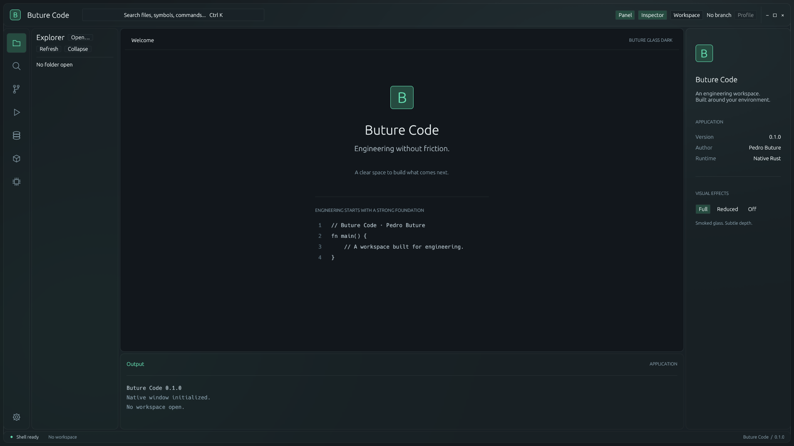

# Buture Code

Workstation de desenvolvimento nativa em Rust, criada por **Pedro Buture**.



## Executar

Requer Rust stable e ambiente gráfico. No Linux, o backend usa OpenGL/EGL, X11 ou Wayland e xkbcommon do sistema. Não há instalação automática.

```sh
cargo run -p buture-app
```

## Marco atual — prompts 01–20

Buture Glass Dark com tokens e GlassSurface centralizados, modos Full / Reduced / Off, janela nativa, activity navigation e sidebar redimensionável.

Explorer real: Open Folder (Ctrl/Cmd+O), pastas sob demanda, watcher por polling, navegação por teclado, seleção, menu contextual e operações de arquivos. Clique expande pastas; duplo clique ou Enter abre preview UTF-8 somente leitura, limitado a 1 MiB. Exclusão permanente exige confirmação. Não há editor editável neste ciclo.

Settings usa camadas Default/User/Workspace em INI legível. O onboarding detecta o host, oferece seleção de linguagens, executa varredura em segundo plano e salva a conclusão. Settings → Development → Toolchains apresenta versões e locais observados de Rust, C/C++, Python, Java, Node.js e Go. Para ferramentas ausentes com método suportado, Install mostra explicação e comando exato, pede confirmação na aplicação e valida o resultado.

Command Center e Profile ainda são placeholders visuais. Áreas de ferramentas posteriores indicam que não estão implementadas. O painel Output não é um terminal. Doctor, LSP, edição, Git completo e demais integrações pertencem aos próximos prompts.

O ciclo autorizado termina no prompt 20. [Resultados e limitações](docs/milestone-20.md).

## Verificação

```sh
cargo fmt --all --check
cargo clippy --workspace --all-targets -- -D warnings
cargo test --workspace
cargo build --workspace
cargo run -p buture-app --example capture_shell -- /tmp/buture-shell-preview
```

O exemplo abre uma janela nativa, captura os modos de efeitos e os fluxos Explorer, Toolchains e onboarding, e encerra. A varredura de QA consulta versões reais; não instala ferramentas nem grava preferências pessoais. A geometria é determinada pelo compositor.

- [Arquitetura](docs/architecture.md)
- [Roadmap](docs/roadmap.md)
- [Design system](docs/design-system.md)
- [Toolchains e instalação assistida](docs/toolchains.md)
- [Segurança](docs/security.md)
- [Dependências](docs/dependencies.md)
- [Third-party notices](THIRD_PARTY_NOTICES.md)

## Direitos

Copyright © 2026 Pedro Buture. Todos os direitos reservados. Nenhuma licença de código aberto foi concedida ao código autoral deste projeto. As dependências mantêm suas próprias licenças.
